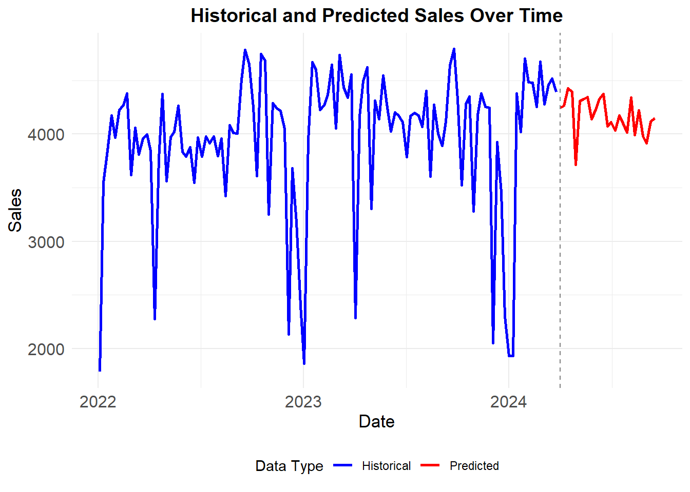
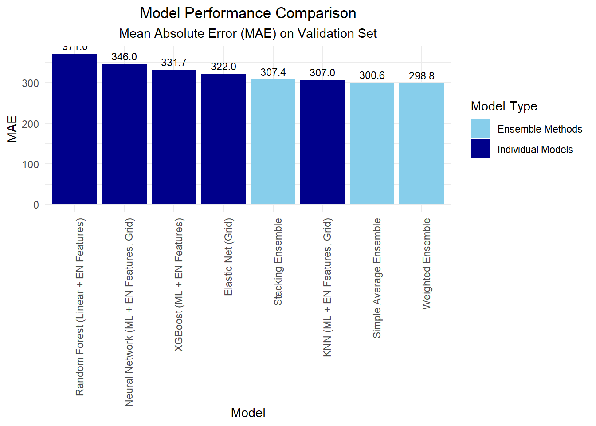
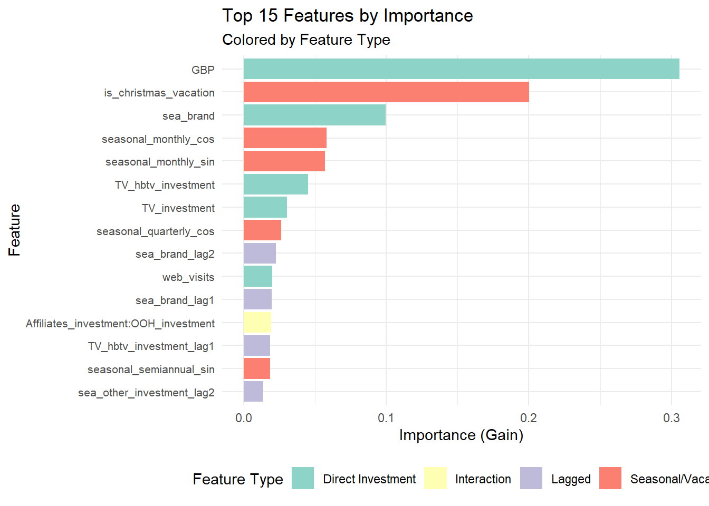

# Weekly Sales Forecasting from Marketing Investment

Forecasting weekly sales from advertising spend, web traffic and calendar effects with time-aware cross-validation: an inverse-MAE weighted ensemble of five models reaches a validation MAE of 298.7548, below every individual model.



## The problem
A company with physical stores and a website records weekly sales together with spend on affiliates, Meta, TikTok, branded and non-branded search ads, TV, connected TV, radio, out-of-home and database marketing, plus web visits, local positioning on Google and number of stores. The task is to predict sales for the 25 weeks without labels (2024-04-01 to 2024-09-16) and to tell which channels actually move sales, so that marketing budget can be reallocated.

## Approach
- **Time-aware splits**: 117 labelled weeks sorted by date; training CV set 2022-01-03 to 2023-10-16, validation set 2023-10-23 to 2024-03-25 (last 20%), no shuffling. Hyperparameters tuned with `caret` time-slice CV (3 iterations, 47-week initial window, 15-week horizon).
- **EDA**: sales distribution and log transform, sparsity of investment variables, correlations, sales over time, cross-correlation of each channel with sales at positive lags, pairwise interaction effects.
- **Feature engineering**: zero-investment indicators, seasonal sine/cosine terms (monthly, quarterly, semiannual), vacation flags (including Christmas), lagged investment features chosen from the cross-correlation analysis, and interaction terms.
- **Models**: Elastic Net (also used for feature selection), Random Forest, XGBoost (default and with regularization), KNN and a single-hidden-layer neural network, each trained on full and Elastic-Net-selected feature sets, with log-transformed (linear) or raw (ML) formulas.
- **Ensembles**: simple average, inverse-MAE weighted average and stacking with a Ridge meta-model.
- **Final forecast**: models retrained on all labelled weeks, weights recomputed from the new cross-validation MAEs, predictions written to `Juanro.csv`.

## Key results
Validation MAE (2023-10-23 to 2024-03-25) of the best configuration of each model:

| Model | MAE |
|---|---|
| **Weighted Ensemble** | **298.7548** |
| Simple Average Ensemble | 300.6478 |
| KNN (ML + EN features, grid search) | 306.9710 |
| Stacking Ensemble | 307.3553 |
| Elastic Net (grid search) | 321.9590 |
| XGBoost (ML + EN features) | 331.7412 |
| Neural Network (ML + EN features, grid search) | 346.0074 |
| Random Forest (linear + EN features) | 370.9809 |



After retraining on all 117 labelled weeks, the cross-validation MAEs are XGBoost 237.0022, Neural Network 285.4576, KNN 296.0877, Elastic Net 318.7759 and Random Forest 391.5681; the final ensemble weights are 0.2512917, 0.2086358, 0.2011454, 0.1868293 and 0.1520979 respectively.

XGBoost feature importance ranks local positioning on Google (`GBP`) first, the Christmas vacation flag second, then branded search ads and seasonal terms; TV, connected TV and lagged branded-search spend also appear in the top 15.



## Stack
R (R Markdown): tidyverse, caret, glmnet, randomForest, xgboost, tidymodels, broom, patchwork, reshape2, gridExtra, ggpubr, readxl.

## Run it
Open `Sales_Predictions_Advanced_Regression.Rmd` in RStudio with `Real_Dataset_HW2.xlsx` in the same folder, install the packages listed in the "Installation and Loading" chunk (`install.packages(c("tidyverse", "caret", "glmnet", "randomForest", "xgboost", "broom", "tidymodels", "patchwork", "reshape2", "gridExtra", "ggpubr"))`) and knit to HTML. The rendered `Sales_Predictions_Advanced_Regression.html` shows all outputs without running anything.

## Repository structure
```
Sales_Predictions_Advanced_Regression.Rmd    analysis source (R Markdown)
Sales_Predictions_Advanced_Regression.html   rendered report with all outputs
Real_Dataset_HW2.xlsx                        weekly sales and investment data
Juanro.csv                                   final sales predictions for the 25 unlabelled weeks
figures/                                     key plots extracted from the rendered report
LICENSE                                      MIT (code)
```

## Context and authorship
- Built as part of the MSc in Big Data Analytics, Universidad Carlos III de Madrid (2024-2025).
- Team project with Rodrigo Castro Freibott.
- Code is released under the MIT License. The dataset was provided for coursework and is included for reproducibility only; its licence is not covered by the MIT License.

## Author
**Juan del Mazo Vázquez** — [Website](https://juandelmazovazquez.vercel.app) · [LinkedIn](https://www.linkedin.com/in/juan-del-mazo-7500a7276) · [GitHub](https://github.com/JuandelMazoVazquez)

<details>
<summary>Resumen en español</summary>

Previsión de ventas semanales a partir de la inversión en canales de marketing (TV, Meta, TikTok, buscadores, radio, exterior, afiliados), visitas web y efectos de calendario. Con validación temporal sin barajar, ingeniería de variables (estacionalidad, vacaciones, retardos e interacciones) y cinco modelos (Elastic Net, Random Forest, XGBoost, KNN y red neuronal), el ensemble ponderado por el inverso del MAE logra un MAE de validación de 298.7548, mejor que cualquier modelo individual (el mejor, KNN, 306.9710). El posicionamiento en Google, las vacaciones de Navidad y la publicidad de marca en buscadores son las variables más importantes.

</details>
